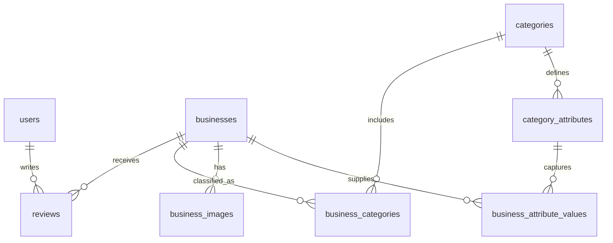

# Relationship and schema changes relative to the submitted ER model

The eight entities and their relationships from `ER model.pdf` remain:

- users 1—N reviews N—1 businesses
- businesses N—M categories through business_categories
- businesses 1—N business_images
- categories 1—N category_attributes
- businesses N—M category_attributes through business_attribute_values

The **database implementation** additionally includes the following non-key metadata, which can be added to the ER diagram if the lecturer needs an exact match:

**`businesses`**: `public_rating`, `public_review_count`, `public_source_name`, `public_source_url`, `public_review_summary`, `public_checked_on`, `address_source_url`.

**`business_images`**: `image_author`, `image_license`, `license_url`, `source_url`, `image_origin`.

No ninth entity is introduced. `reviews` is still the table for **first-party BisLK reviews only**. The published aggregate scores are separate metadata snapshots with verified citations, since it would be false to invent registered users or third-party review records. The initial `reviews` table has zero rows; you fill it through the app.

## ER relationship view (Mermaid)

